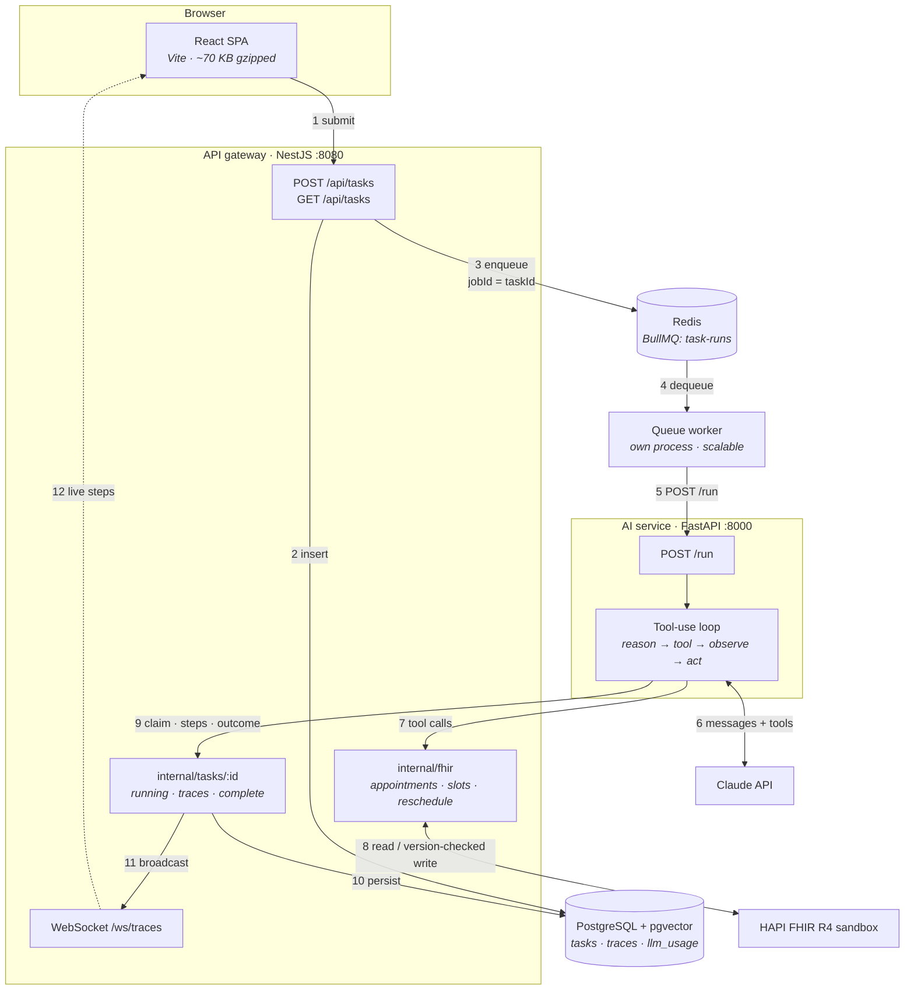
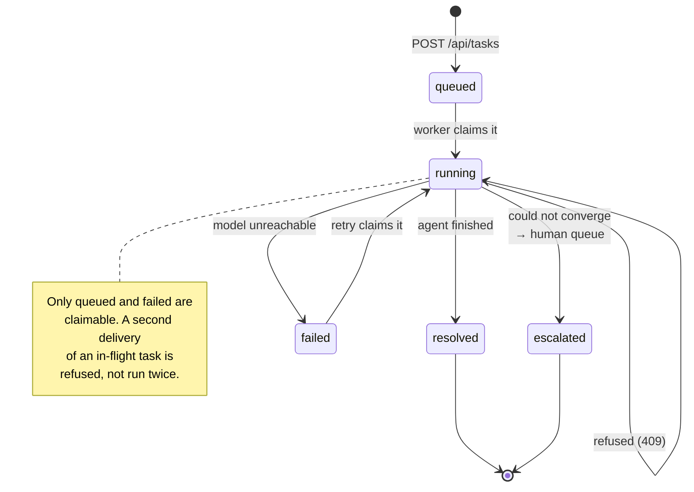
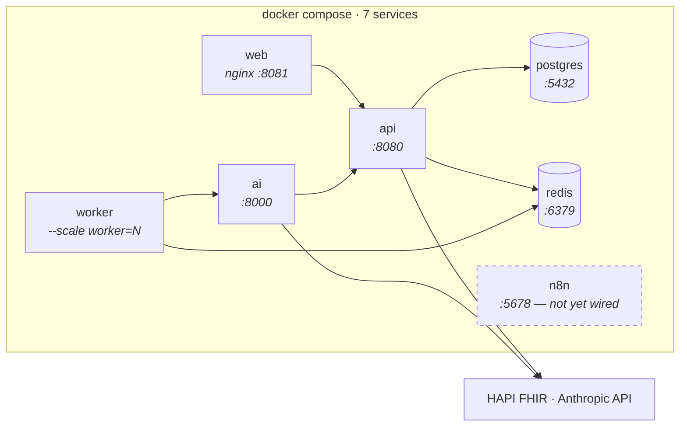

# Architecture diagrams

Mermaid source, rendered by GitHub directly. Kept as text rather than exported
images so a diff shows what changed about the system, not that some pixels moved.

These describe **what is built today**, not the target. Planned components are
drawn dashed and labelled.

---

## Request path: a message becomes a rescheduled appointment

**The two boundaries that carry the design:**

- The AI service holds no database connection and speaks no FHIR. Steps 7 and 9
  both go through the gateway ([ADR-004](../adr/ADR-004-postgres-ownership-and-drizzle.md),
  [ADR-008](../adr/ADR-008-fhir-access-through-the-gateway.md)), so optimistic
  concurrency exists once and PHI access is auditable in one place.
- Step 9's first call is a *claim*, not a status update. It is refused if
  another run already holds the task, which is what makes the queue's
  at-least-once delivery safe ([ADR-007](../adr/ADR-007-queue-and-worker-topology.md)).

---

## Task lifecycle

The status field is a state machine, and the queue depends on it being one.

---

## Deployment topology (local, `pnpm up:all`)

Every host port is overridable in `.env`. The scripts pass `--env-file .env`
explicitly, because Compose resolves its env file relative to the compose file
and would otherwise ignore those overrides entirely.
